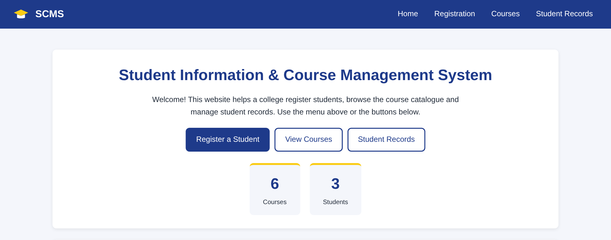
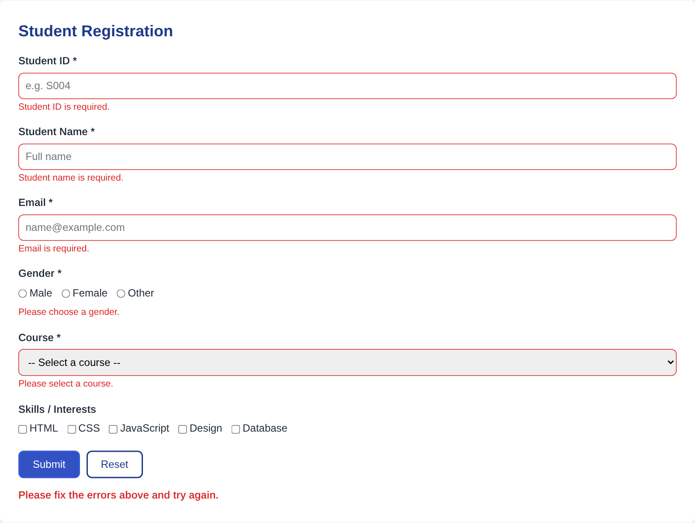
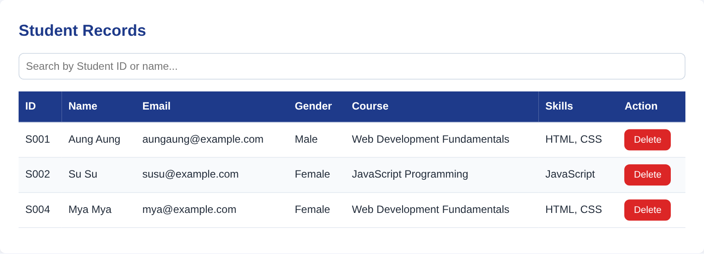

# Student Information and Course Management System

Final project for **Web Programming** (HTML, CSS, JavaScript) by **Aung Paing Soe** (Branch-9), European International University / MMR Institute.

A static website for registering students, browsing courses and managing student records. No server or database is needed; it runs entirely in the browser.

## Features
- **Student registration form** with validation (required fields, email format, duplicate Student ID check) and error/success messages
- **Course catalogue** with search and duration filter
- **Student records** shown dynamically in a table, with search by ID or name and delete
- Records are kept in the browser's `localStorage`, so they survive a page refresh
- Responsive layout with a mobile menu

## Run locally
Open `index.html` in any modern browser.

## Screenshots

## Acknowledgement
This project was prepared with AI assistance (Grok Bot), disclosed in line with the lecturer's and university's policy.
